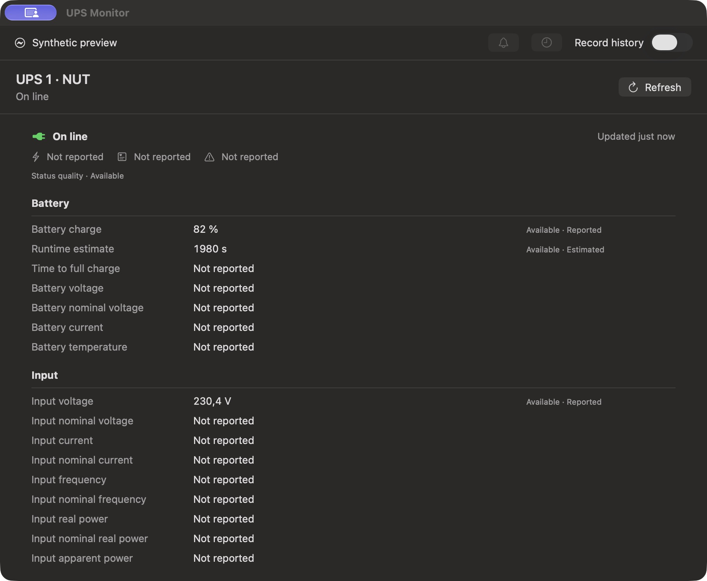
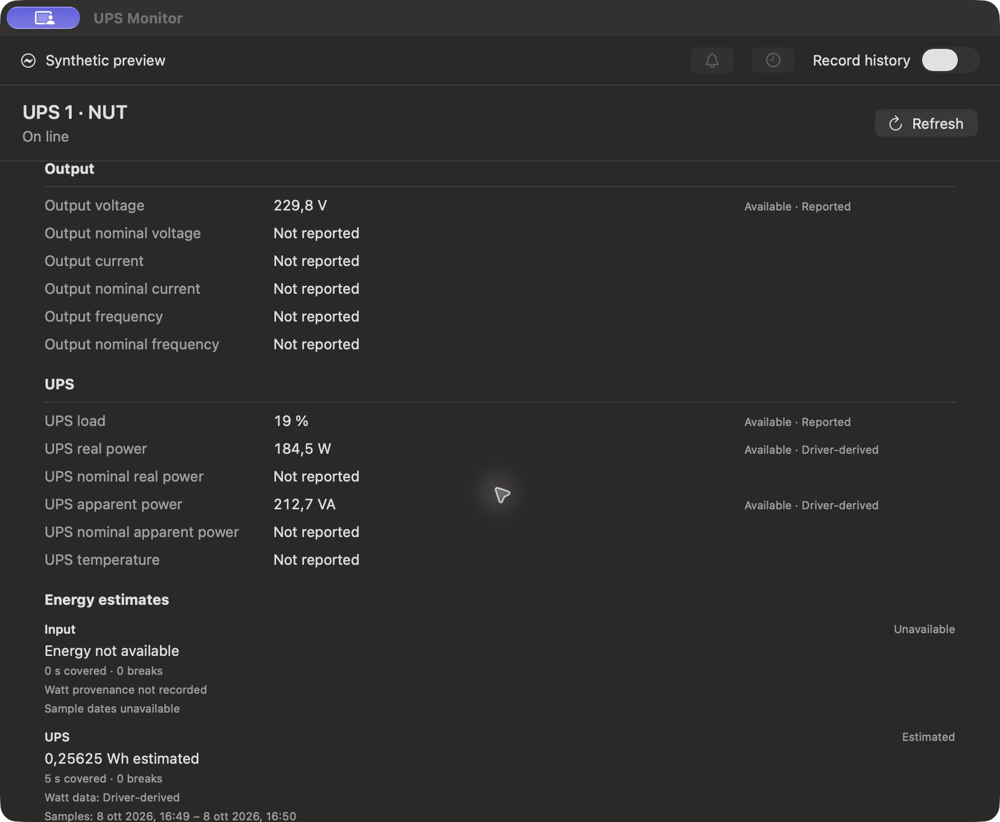
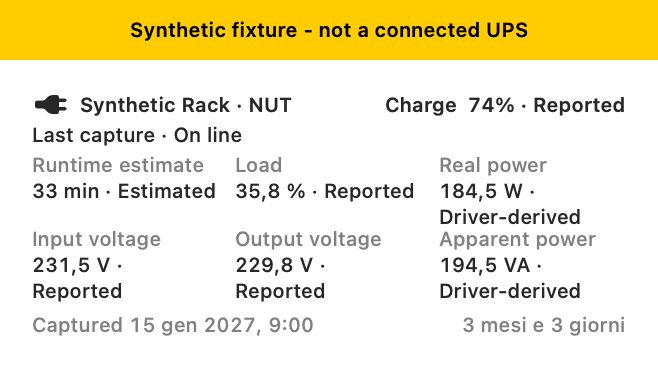

# UPS Monitor Mac

<p align="center">
  
</p>

<p align="center">
  <a href="https://github.com/pettipol/ups-monitor-macos/actions/workflows/ci.yml?query=branch%3Amain"></a>
  <a href="LICENSE"></a>
  <a href="docs/COMPATIBILITY.md"></a>
  <a href="docs/VERSIONING.md"></a>
</p>

**A local-first, read-only UPS monitor for macOS.** It combines Apple power-source observations with an optional user-configured Network UPS Tools (NUT) client path, and presents available readings in a menu-bar app, details window, local history, and a WidgetKit extension.

> **Source preview · `0.1.0-preview.1` · No public app release**
>
> A synthetic app session received two fixture samples after Start, then stopped and quit normally. A system-hosted synthetic widget was observed after Stop. These checks do not qualify a real UPS, live widget freshness, full GUI/accessibility behavior, or target-specific compatibility. The deployment target and CI badge are not compatibility claims. See [visual evidence](docs/SCREENSHOTS.md), [widget limits](docs/WIDGET_SIGNING.md), and the [release checklist](docs/RELEASE_CHECKLIST.md).

## What It Measures

In a bounded USB session on an APC Smart-UPS C 1500 (SMC1500I), the reader
recorded battery charge and estimated runtime, mains and output voltage and frequency,
output current, battery voltage, temperature and percentage load. The reader
derives active watts and apparent volt-amperes from the corresponding load
percentages and nominal ratings. Apparent load is experimental. The recorded
fields contained no Wh or kWh counter. The app showed fresh samples, then
Stop returned an error. Normal Stop, sustained use and real-device widget refresh remain open.

The advanced reader in the local development package requires Apple Silicon
and macOS 27 or later. An ordinary app launch uses Apple power sources.
The E84 local preview includes the rebuilt app and widget and the signed
reader and helper from E80. The extracted app opened a window in synthetic
preview mode and quit normally. The offline source kit was regenerated with
byte-identical contents. Advanced hardware qualification uses a separate
candidate. See [compatibility](docs/COMPATIBILITY.md),
[offline build inputs](docs/OFFLINE_DEVELOPER_KIT.md) and the [packaging procedure](docs/REAL_PREVIEW_PACKAGE.md).
For the separate source handoff, follow the [frozen E109 delivery recipe](docs/SOURCE_HANDOFF.md).

| Area | What the code provides | Evidence and boundary |
|---|---|---|
| Synthetic app interaction | One fixture-backed session with Start, two displayed samples, normal Stop and Quit | Observed in one synthetic session. It does not establish real UPS acquisition, continuous operation, full GUI acceptance, accessibility, menu-bar behavior or live widget freshness; see [visual evidence](docs/SCREENSHOTS.md). |
| Apple power-source service | Sanitized UPS status, battery charge and battery voltage when reported | One qualitative native observation is recorded. It did not provide AC voltage or active watts; it is not device compatibility or sustained-read evidence. |
| NUT client path | Allowlisted decoding, bounded local client, and optional configured source | Synthetic loopback fixtures only. No live NUT server or UPS compatibility is claimed. This client path does not install or start a driver or server. |
| Experimental managed USB collector | Bounded development profiles for APC SMC1500I, with separate real and simulated receipts | The collector produced 24 renewed samples in an earlier bounded run. Later app-based readings reached the GUI on the SMC1500I. A normal Stop on the real device and daily operation still require qualification. See [managed native runtime](docs/MANAGED_NATIVE_RUNTIME.md). |
| Archived observations | Explicit folder import with a separately supplied executable pin, original timestamps and per-field provenance | Always archived and unqualified, never sent to live monitoring, widgets, history, energy or alerts. Unsigned receipt consistency is not hardware authenticity. See the [archive contract](docs/NUT_APP_CONTRACT.md#explicit-archive-detail); native archive-sheet interaction remains unqualified. |
| Energy estimates | Integrates eligible active-watt samples separately for the input and UPS channels and exports Wh estimates with time coverage and gaps | Tested with synthetic data. H09 supplied derived UPS watts. Real-session energy coverage and agreement with a meter remain unverified. |
| Local history | Explicitly opt-in SQLite recording, bounded browsing and JSON/CSV export | Recording defaults off. Synthetic tests do not establish long-term retention behavior on a user account. |
| Widget | Small and medium views. The medium view can show charge, estimated runtime, load, W, VA and input/output voltage when supplied. | The E70 medium desktop widget showed simulated readings (74%, 35 min, 180 W and 215 VA), then “Stopped · stale · On line” after Quit. W and VA were derived. The first publication, the first sample of a new session and publication of the stopped state can request an immediate refresh. With an unchanged state, ordinary requests are at least five minutes apart. A source or status change can request one after 30 seconds. WidgetKit decides when to redraw. Live-session freshness and real-UPS values in the widget still need verification. H09 reported no Wh/kWh counter. See [visual evidence](docs/SCREENSHOTS.md) and [widget signing and limits](docs/WIDGET_SIGNING.md). |
| Alerts | Optional, default-off session alerts for selected monitoring conditions | macOS authorization and actual banner presentation remain unqualified. Alerts are not shutdown protection. |

The native service observation excluded the Mac's internal battery from monitored sources. No USB interface was opened. Readings can be missing; missing is never represented as zero. Watts (`W`), volt-amperes (`VA`) and estimated watt-hours (`Wh`) are distinct quantities, with derived values, estimates and stale captures labelled. See the [compatibility matrix](docs/COMPATIBILITY.md) and [native observation](docs/NATIVE_BASELINE.md) for the evidence boundary.

**Not a shutdown controller:** there are no UPS control commands, self-tests, calibration, buzzer operations, driver installation, background service, required account, network telemetry or cloud dependency. Do not disable existing macOS power-management services to use this project.

## Visuals

These screenshots show the macOS app running its explicit **Synthetic preview**. Every value is fixture data: these are **not UPS measurements**. They show application windows, not an installed WidgetKit extension. The [visual evidence gallery](docs/SCREENSHOTS.md) records their provenance and separately documents the synthetic app session and stopped widget observation.

<p align="center">
  
  
</p>

The gallery also shows [an archived observation imported from a synthetic fixture](docs/SCREENSHOTS.md#archived-observation-import--synthetic-data), with its original times and unqualified-data labels.

**Medium widget layout with simulated readings.** The renderer uses the project's widget view and a synthetic fixture. Desktop refresh during a real session still needs to be observed.



See the [gallery](docs/SCREENSHOTS.md) for provenance and the earlier [rendering checks](docs/RENDER_PROBE.md).

## Quickstart

For a versioned source download, use the [prereleases](https://github.com/pettipol/ups-monitor-macos/releases)
and follow the [archive verification steps](docs/SOURCE_RELEASE.md). The
maintainer-attached `-source.tar.gz` asset has its own SHA-256 file. It contains
source, not an installable app or a NUT driver. GitHub's automatically generated
source ZIP/tar links are separate artifacts and do not share that checksum.

The local check on 2026-11-05 covered 723 Python tests across the main and separate reader suites, and 453 distinct Swift tests including the two optional NUT client cases on simulated localhost servers. Swift and Xcode Release builds passed. The Swift compilation resumed after the local process monitor interrupted the first attempt. See the [validation procedure and scope](docs/VALIDATION.md).

The hosted [CI run 44925373618](https://github.com/pettipol/ups-monitor-macos/actions/runs/44925373618) completed both jobs successfully on 2026-11-21 for tree `806bc3a949a012453559a33e53b681b8dbeb3b8a`. [PR #1](https://github.com/pettipol/ups-monitor-macos/pull/1) was a draft at that checkpoint. The run counted 739 Python tests (667 in the source/tests/ad-hoc-build job and 72 reader contracts) and 453 passing Swift test definitions (296 XCTest and 157 Swift Testing), with two optional `upsc` XCTest cases skipped. The app completed an ad-hoc build. This dated result covers that tree only: it does not cover later local changes, hardware, UI/widget behavior, continuity or release. See [CI status](docs/CI.md), the [validation scope](docs/VALIDATION.md) and the historical [2026-11-04 local baseline](docs/LOCAL_VALIDATION_2026-11-04.md).

A separate complete synthetic package composition used a frozen 504-file source
tree (5,787,739 bytes) and completed 25 bounded commands in 57.314 seconds.
The static closure had 25 entries and nine external backend modules bound to
the E60 process-deadline source. Four signature verifications passed, with 25
notice files copied and checked. No product process was launched or UPS/hardware
accessed. These checks did not repeat the test suites or qualify runtime,
reproducibility, distribution or third-party redistribution. See the
[packaging result](docs/LOCAL_VALIDATION_2026-11-04.md#packaging-2026-11-04-e61)
and [build recipe](docs/FROZEN_BUILD_RECIPE.md).

The 2026-11-21 first-IO candidate completed a fresh offline native build and
local app/widget packaging with local signing. Static checks passed, including
a same-machine archive restore with four signature verifications. The helper was reused from
the previously checked candidate; the native reader was freshly built. The
product was not launched. Current UI, Stop behavior, continuity, independent
installation, byte-for-byte reproducibility and redistribution are not
qualified. See [validation](docs/VALIDATION.md) and
[distribution readiness](docs/DISTRIBUTION_READINESS.md).

```sh
git clone https://github.com/pettipol/ups-monitor-macos.git
cd ups-monitor-macos

# Synthetic parser/preflight checks, Swift/Python tests, and ad-hoc build checks.
bash scripts/check.sh
```

The script does not launch the app, widget, probe, or UPS driver. To build and open the app in its explicit synthetic preview:

```sh
xcodebuild -project UPSMonitor.xcodeproj -scheme UPSMonitor \
  -configuration Debug -derivedDataPath .build/app build
open '.build/app/Build/Products/Debug/UPS Monitor.app' --args --synthetic-preview
```

The synthetic preview uses fixture data and does not start live acquisition or history recording. The default local build has no App Group configured and is not a notarized distribution.

For the difference between this source build and the separately packaged local
app, see [Which app to open](docs/GUIDA_ITALIANA.md#quale-app-aprire). The E80
archive is a local development package, not a public release; it was restored
and signature-checked, but not launched in that packaging qualification.

## Optional Native Read

This is separate from the quickstart and the synthetic preview. After reviewing the [native baseline](docs/NATIVE_BASELINE.md), an explicit one-shot session probe can read the existing Apple power-source service:

```sh
swift run ups-probe --session
```

It emits sanitized JSON with opaque process-local source IDs. It does not open USB interfaces or start an UPS driver. This command is not a NUT test and does not qualify compatibility. The separate experimental [managed native profile](docs/MANAGED_NATIVE_RUNTIME.md) has one bounded collector observation, not daily-use qualification; its app path is developer-only and requires a reviewed, explicitly authorized hardware trial. The quickstart does not start that profile.

## Architecture

- `ApplePowerSource` reads the documented Apple service; `UPSRuntime` coordinates snapshots and adapts the optional NUT client path.
- `UPSModel` defines the shared typed snapshot, units, status, provenance and validation rules.
- `UPSMonitorUI` contains menu, details, energy and history presentation components; `UPSAppHost` connects those components to app state.
- `UPSEnergy` integrates eligible input and UPS active-watt samples in memory; `UPSHistory` provides opt-in local persistence and browsing.
- `UPSWidgetData`, `UPSWidgetBridge` and `UPSWidgetUI` define the latest-snapshot path and widget view. Synthetic App Group publication has been observed; real-device widget operation remains unqualified.

## Project Status

The current source version is `0.1.0-preview.1`; it is a preview label, not a public app release or download. Hosted CI runs synthetic tests, release builds, plist checks and an ad-hoc signature check. It does not launch the app or probe hardware; optional NUT-client interop is separately gated. See the [CI record](docs/CI.md) for the exact run, toolchain and skipped checks.

The H13 terminal trial recorded eight fresh samples from the SMC1500I. All trial processes closed after the requested Stop, but the reader reported a guard error. Clean Stop and fresh real-device readings on the desktop widget still require verification. The medium E70 widget has shown simulated readings and a stopped/stale state after Quit. Observing consecutive fresh readings during a managed session remains open. Further release work includes GUI and accessibility review, notification presentation, hardware coverage and distribution checks. See the [release checklist](docs/RELEASE_CHECKLIST.md).

## Documentation

| Topic | Document |
|---|---|
| Architecture and app host | [Architecture](docs/ARCHITECTURE.md) · [App host](docs/APP_HOST.md) |
| Data, privacy and security | [Privacy policy](PRIVACY.md) · [Security reporting](SECURITY.md) |
| Compatibility and observations | [Compatibility matrix](docs/COMPATIBILITY.md) · [Native baseline](docs/NATIVE_BASELINE.md) |
| NUT | [Feasibility and boundaries](docs/NUT_FEASIBILITY.md) · [Runtime](docs/NUT_RUNTIME.md) · [Client completion qualification](docs/NUT_CLIENT_COMPLETION.md) · [Experimental driver guards](docs/NUT_GUARDS.md) · [Open upstream issues](docs/NUT_UPSTREAM_STATUS.md) |
| App-controlled capture | [Control pipe and ownership](docs/APP_CONTROLLED_CAPTURE.md) · [Managed native 120-second candidate](docs/MANAGED_NATIVE_RUNTIME.md) |
| Offline NUT candidates | [Shared USB state](docs/NUT_ASYNC_STATE_CANDIDATE.md) · [Guarded IN observation budget](docs/NUT_GUARD_DEADLINE_CANDIDATE.md) · [Ownership retention](docs/NUT_OWNER_RETENTION_CANDIDATE.md) · [Protocol evidence](docs/NUT_PROTOCOL_EVIDENCE.md), not installed or hardware-qualified |
| History and energy | [History storage](docs/HISTORY.md) · [History browsing](docs/HISTORY_BROWSING.md) · [Energy tracker](docs/ENERGY_TRACKER.md) · [Energy UI](docs/ENERGY_UI.md) |
| Widget and alerts | [Widget signing and limits](docs/WIDGET_SIGNING.md) · [Alert policy](docs/ALERT_POLICY.md) · [Alert delivery](docs/ALERT_DELIVERY.md) |
| Build and release | [CI](docs/CI.md) · [Local validation](docs/VALIDATION.md) · [Versioning](docs/VERSIONING.md) · [Release checklist](docs/RELEASE_CHECKLIST.md) |
| Project and participation | [Presentation notes](docs/PROJECT_PRESENTATION.md) · [Screenshots and visual evidence](docs/SCREENSHOTS.md) · [Contributing](CONTRIBUTING.md) · [Third-party notices](THIRD_PARTY_NOTICES.md) · [Changelog](CHANGELOG.md) |
| Italiano | [Guida italiana](docs/GUIDA_ITALIANA.md) |

## License

Original project code is MIT-licensed; third-party components retain their own terms. NUT-derived patches and their applicable license are documented separately in [third-party notices](THIRD_PARTY_NOTICES.md). This source preview does not distribute a NUT binary. See [LICENSE](LICENSE) and the notices before reuse or redistribution.

The continuous backend remains experimental. Its public-source offline replay and
diagnostic formatter have been checked; this does not resolve or qualify the live
continuous path. See [current offline evidence and remaining gates](docs/CONTINUOUS_OFFLINE_QUALIFICATION.md).
