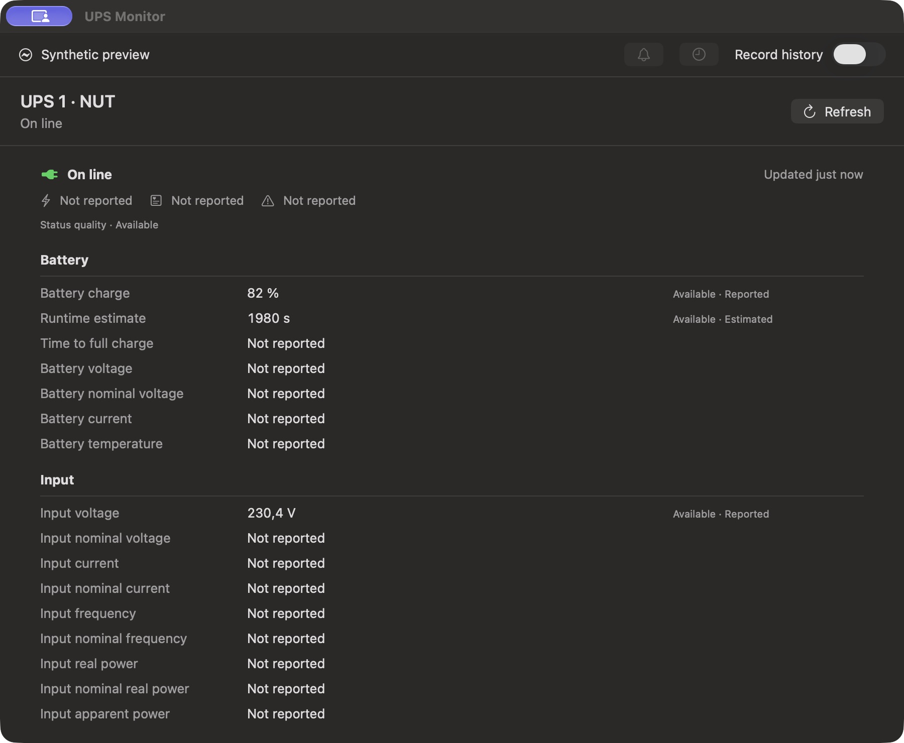
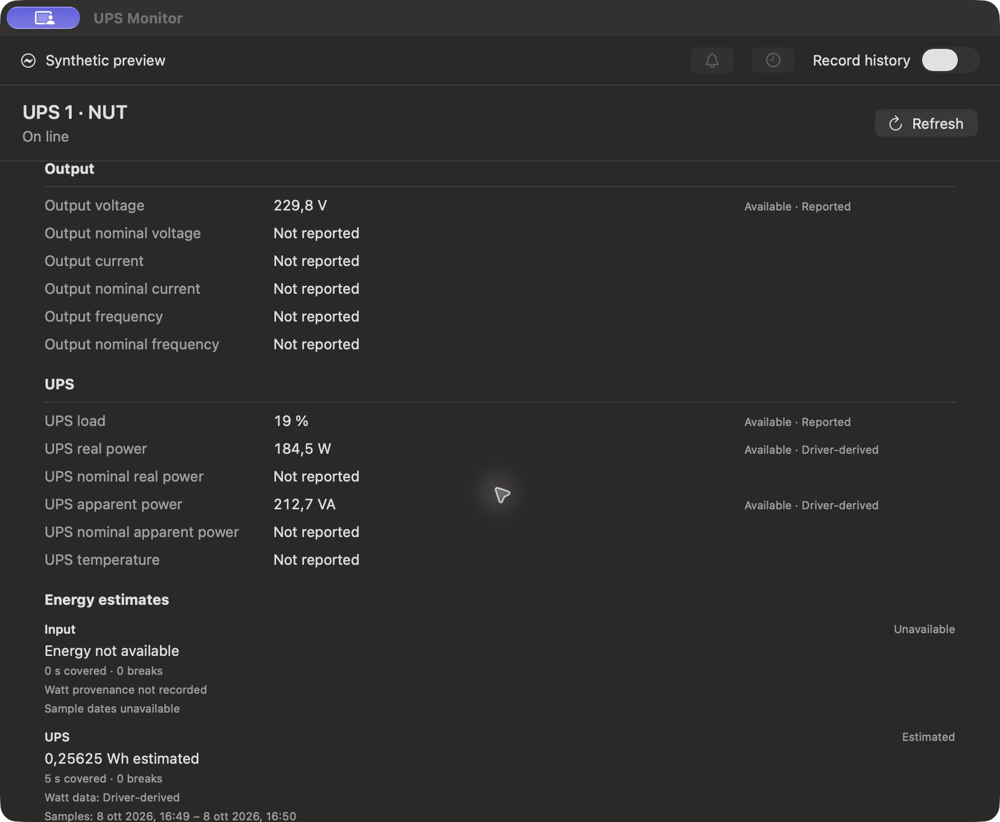
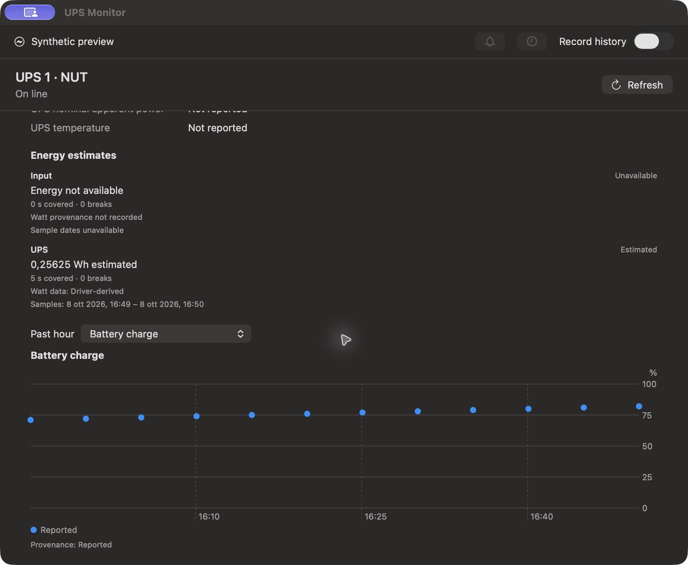
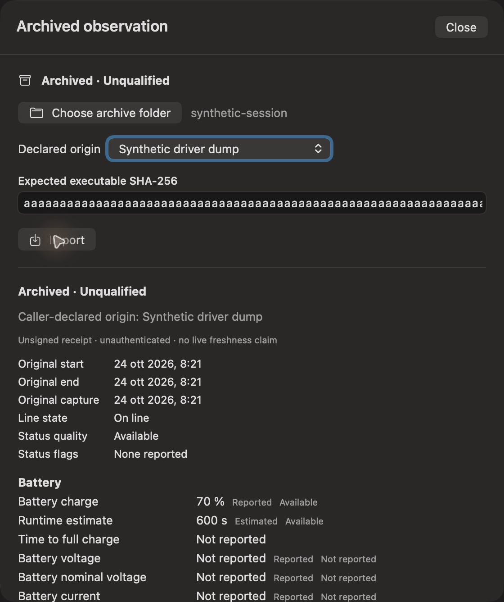
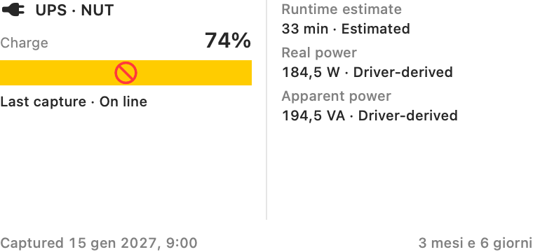
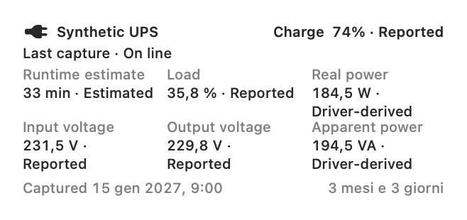
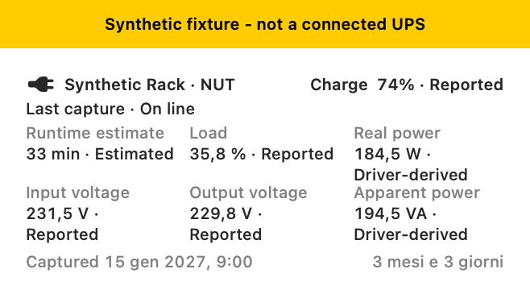
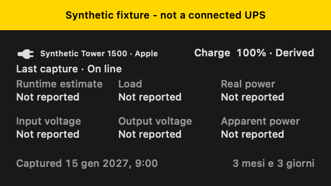

# Screenshots and Visual Evidence

Initial app captures were reviewed on 2026-10-08; the compact widget preview
was added on 2026-10-11 and the archive import capture on 2026-10-24.
These are original project artifacts, not
marketing mockups. All displayed readings are **synthetic fixtures**, not
measurements from a connected UPS.

No installed-widget screenshot has been exported. On 2026-11-04, the
system-hosted synthetic widget from the earlier E57/E58 candidate was visually
observed inline in small and medium sizes after Stop; its values came from that
fixture and no image file was saved. The E61 widget was not observed during the
later E62 session. Neither observation is a real-UPS measurement or a live-update
qualification.

## Installed E70 medium widget, November 6, 2026

The identified WidgetKit extension displayed the ordinary synthetic fixture on the macOS desktop. Before its first publication the medium widget read **Shared data unavailable**. It subsequently showed **74%** charge, **35 min** estimated runtime, **180 W** and **215 VA**, both power values labeled driver-derived. Load and input/output voltage were shown as **Not reported**. Immediately after an app refresh the desktop widget still displayed an older capture. After normal Quit, the same medium widget showed **Stopped · stale · On line** with a later capture time and the readings retained.

The signed candidate was observed directly. The retained evidence is a transcript because the archived image response was truncated. The supervised managed-session attempt had already timed out before Start. The observations above concern the ordinary simulated fixture.

## Running App

The following unedited, window-only JPEGs were captured from the actual native
app launched with `--synthetic-preview`, on macOS 27.0.1 / Apple Silicon.
The Release build used application/view code at source commit
`fa32a3577b1d928532c0c417fc31f2538ea2efd8`; subsequent source-version metadata
and documentation changes do not change these views. Each image is 1800 x 1480
pixels (a 900 x 740 point window). English app strings and the host's Italian
number/date formatting are both visible. The colored title-bar sharing indicator
belongs to macOS capture, not the product's design or a cloud feature.

### Battery and Input

The fixture supplies charge, a runtime estimate and an input voltage. Missing
fields remain "Not reported". This is a view demonstration, not evidence that
Apple's native service supplies those AC readings or that this UPS reports them.

### Output and Power

Output voltage, load, active power and apparent power are distinct rows. The
fixture deliberately labels watts and VA as driver-derived. "UPS real power"
is not automatically an output-location measurement. The scroll viewport clips
the continuation of the energy section; the next image shows that section.

### Energy and History

The UPS energy estimate has only five covered seconds. Input energy is
unavailable because eligible input watts are absent. The battery-charge plot is
synthetic history; recording is off. Neither this image nor the fixture's clock
is evidence of continuous live acquisition or energy-meter accuracy.

## Archived Observation Import — Synthetic Data

This unedited, window-only capture was taken on 2026-10-24 from the native
Release app running `--synthetic-preview` on macOS 27.0.1 / Apple Silicon.
The imported bundle is a synthetic fixture: 70% charge and 600 seconds of
estimated runtime are demonstration values, not measurements from a UPS.
The original fixture times remain visible. The all-`a` executable hash is
deliberately fake; matching it does not authenticate an archive or a device.

The view keeps `Archived · Unqualified`, caller-declared synthetic origin,
and the unsigned-receipt/no-live-freshness labels visible. Importing the bundle
does not replace the main preview snapshot. Lower rows are outside the viewport;
this image does not demonstrate continuous monitoring or an installed widget.

The local working-tree build includes `ArchivedObservationView.swift` at SHA-256
`abb061e8ba4417eb42feb9d7993599610c3edbdf436ab0112b9d4b57be0e3a30`.
The folder accessibility label/value was checked before selection, after selection
and after changing folders; the import flow was exercised afterward. This is an
accessibility-tree check, not a VoiceOver qualification. The JPEG is 1120 × 1336
pixels, SHA-256 `d3b1bd3afca75d4fc3078589ab62768abbc24da7672bcaf683e542850c9190e1`.

## Widget View: Offscreen Only

This is an existing `ups-render-probe` output from the same source revision,
rendering `UPSWidgetView` directly with SwiftUI `ImageRenderer`, at 380 x 180
points / scale 2. It does **not** run WidgetKit, the timeline provider or App
Group storage, and is **not** a screenshot of a desktop-installed widget.

The yellow blocked bar is the renderer's unsupported-control placeholder for
`ProgressView`, not the proposed final UI. The fixture uses a January 2027 date,
while the relative-date label follows the October 2026 host clock. Do not infer
live freshness, final proportions, enlarged-text support or production behavior
from this canvas. See [render limitations](RENDER_PROBE.md) and
[the outstanding widget checks](WIDGET_SIGNING.md).

## Compact Medium Preview (2026-10-11)

This compact canvas is 329 x 155 points (658 x 310 pixels at scale 2), with a
16-point inset. It shows the Unreleased expanded medium layout. The probe
renders `UPSWidgetView` directly with SwiftUI
`ImageRenderer` using synthetic fixtures. The coordinator visually reviewed
the rich, partial, and large-stale variants: all six cells and the load, input,
and output values were visible, with units and provenance and the not-reported
or stale labels legible and no overlap observed in those three canvases.

This remains an offscreen preview, not an installed widget or a WidgetKit host
render. It does not establish VoiceOver behavior. The fixture presentation date
is January 2027 while relative-date text follows the host clock; that mismatch
remains a limitation. The image is a visual reference, not evidence of real UPS
data or new hardware compatibility.

## Named Medium Preview (2026-10-11)

This is a 329 x 155 point widget body plus a 30-point banner, rendered at scale
2 with fixture measurements and a synthetic name. It exercises the production
name-label path without querying a device. The named short/long medium and small
canvases were visually inspected; long names are abbreviated and the full label
is supplied in the view's accessibility text, but VoiceOver was not tested.
The small canvas retains the renderer placeholder and abbreviated footer. The
January 2027 fixture date mismatch described above still applies. This image
is not evidence of an installed widget or live target-UPS telemetry.

## System-Hosted Widget: Synthetic Stopped Snapshot (2026-11-04)

The system-hosted **UPS Monitor Synthetic Test** widget was visually observed
in small and medium sizes after the E57 fixture session stopped. The medium
view showed 91% charge, a 49.92-minute estimated runtime,
`Stopped · stale · On line`, and the original acquisition time. These were
synthetic fixture values. The observation was inline only; no screenshot was
exported. It does not show updates while acquisition is running, real UPS
readings, long-term freshness, VoiceOver or daily use. See [widget signing and
limits](WIDGET_SIGNING.md) and the [release checklist](RELEASE_CHECKLIST.md).

## App Interaction Checks: Partial

### Synthetic Preview (2026-10-11)

The coordinating reviewer observed these synthetic app behaviors:

- The details window opened and exposed its text and controls to the inspection
  tool; alerts, stored-history browsing and recording were disabled in preview.
- Scrolling reached power, energy and history without observed text overlap in
  this one default-size dark-mode window.
- Selecting UPS real power in the history picker showed "No history data",
  rather than inventing samples absent from the charge-only fixture.
- Refresh kept the static preview unchanged.
- The normal application-menu Quit command ended the owned process; reopening
  with the same explicit preview flag succeeded.

This `--synthetic-preview` mode does not publish to the shared widget cache.
The check is not full accessibility or UI acceptance. VoiceOver, enlarged text,
light mode, other window sizes, menu-bar popover behavior, actual history and
exports, notifications and backend settings remain unqualified.

### Managed Synthetic Session (2026-11-04)

In the E62 session on the assembled E61 synthetic package, the app opened idle,
showed 90% charge / 3,000 seconds and then 91% / 2,995 seconds after one Start,
stopped normally with the final sample marked stale, and quit normally. The
managed receipt records two samples and confirms child reap, process-group
absence, both output EOFs and consumer quiescence. The UI was inspected through
the existing accessibility binding. No image file was exported. This bounded
synthetic lifecycle observation does not prove real UPS communication, driver
cleanup, long-running continuity, full GUI accessibility or widget refresh
during acquisition. The E61 widget extension was not observed; the separate
stopped/stale small and medium widget observation above belongs to E57/E58. See
the [managed runtime contract](FROZEN_OPERATIONAL_RUNTIME.md) and [release
checklist](RELEASE_CHECKLIST.md).

## Compact Apple Name Preview (2026-10-11)

The fixture's full name includes a firmware/ID suffix; the visible medium title
omits it while preserving the provider. This unedited ImageRenderer output is
658 x 370 pixels, including the 30-point synthetic banner. Missing metrics are
intentional. Root inspected the small and medium variants; only the medium
is shown here. This is not a desktop widget screenshot, and the future fixture
date versus host-relative date limitation still applies.

## Asset License

The project mark is an original MIT-licensed vector asset. It is a repository
identity mark, not an installed app icon or an APC/Apple/NUT logo. Screenshots
are genuine captures of this project's UI and contain no hardware identifiers,
account data or private desktop content. They are distributed with the project
under its license; third-party platform symbols remain subject to their owners'
terms. No image was generated or retouched to imply a passing hardware test.
